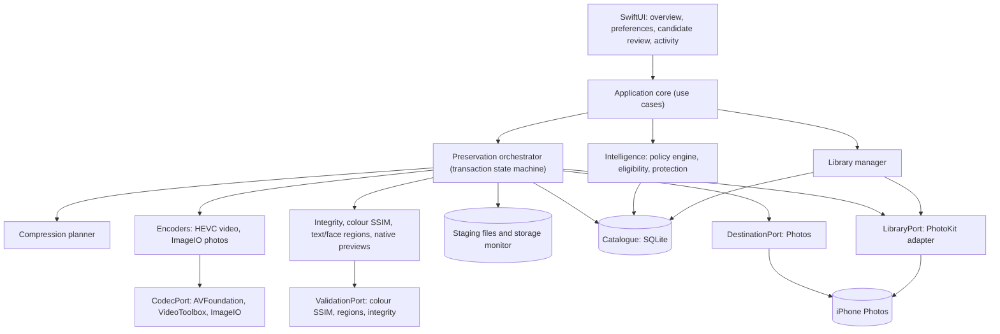
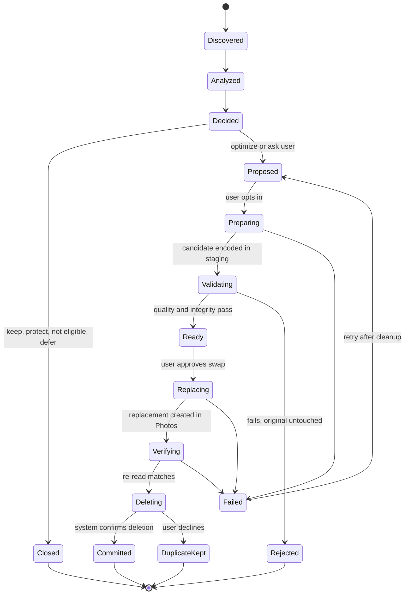

# Architecture

Status as of 2026-11-07. The destination is Photos, per
[ADR-0002](adr/0002-preserved-output-destination.md).

## High-level design

Data flow for one item:

1. The adapter enumerates assets into `MediaAsset` records in the catalogue.
2. The policy engine reads the persisted per-item mode and protections. Unassigned items ask for a
   choice; protection bypasses optimization. Only an explicit optimization mode triggers probing.
3. Analysis reads format, size and content hints locally. Unchanged revisions reuse analysis.
   The UI shows explained recommendations; the user opts in to prepare candidates.
4. The orchestrator opens a transaction. The planner picks the encoding and the storage monitor
   checks the staging budget.
5. The encoder writes a candidate to staging. Validators check integrity, colour similarity,
   thumbnail-scale similarity and detected text/face regions. Photo dimensions are retained;
   Space first videos may reduce to 720p, with original-resolution fallbacks.
6. The user approves the validated candidates. The destination places the replacement in Photos,
   the adapter verifies it, including native fit/fill previews, requests original deletion
   (a system prompt), and the
   catalogue commits.

Approval repeats candidate validation and checks the frozen source revision and current permission
before import and deletion. Old candidates without the current policy, profile and source snapshot
cannot be approved. The new asset has a new identifier; the catalogue resyncs after replacement.

There is no full-media mirror or thumbnail archive in the app. PhotoKit provides selection previews;
the temporary candidate is used only for review/processing. The Photos copy is the playable asset in
both apps. The persistent catalogue stores modes, metadata, findings and audit events, not OCR text.

## Layers

The core is pure Swift behind protocols ([ADR-0001](adr/0001-ports-and-adapters.md)). Adapters
import Apple frameworks and compile only on CI.

The core is the Swift package in [core/](../core/). Its tests run on a Mac in Codemagic; the nested
GitHub workflow definitions are not automatically discovered in the current Git layout.
The adapters, SwiftUI screens, native tests and end-to-end UI test are in
[app/](../app/). Photos has no vault in v1, so `PhotosDestination` is the only destination.

## Classes

```mermaid
classDiagram
    class MediaAsset
    class PreservationDecision
    class EligibilityRules
    class PreservationPolicyEngine
    class CompressionPlanner
    class QualityPolicy
    class PreservationTransaction
    class PreservationOrchestrator
    class MediaLibraryManager
    class LibraryPort
    class CodecPort
    class ValidationPort
    class StoragePort
    class DestinationPort
    class CatalogueStore
    <<interface>> LibraryPort
    <<interface>> CodecPort
    <<interface>> ValidationPort
    <<interface>> StoragePort
    <<interface>> DestinationPort
    <<interface>> CatalogueStore
    PhotoLibraryAdapter ..|> LibraryPort
    PhotosDestination ..|> DestinationPort
    VideoCompressionEngine ..|> CodecPort
    ImageCompressionEngine ..|> CodecPort
    QualityAssessmentEngine ..|> ValidationPort
    IntegrityValidator ..|> ValidationPort
    StorageMonitor ..|> StoragePort
    SqliteCatalogueStore ..|> CatalogueStore
    PreservationPolicyEngine --> EligibilityRules
    PreservationPolicyEngine ..> MediaAsset
    PreservationPolicyEngine ..> PreservationDecision
    CompressionPlanner ..> PreservationDecision
    PreservationOrchestrator --> PreservationPolicyEngine
    PreservationOrchestrator --> CompressionPlanner
    PreservationOrchestrator --> QualityPolicy
    PreservationOrchestrator --> PreservationTransaction
    PreservationOrchestrator --> LibraryPort
    PreservationOrchestrator --> CodecPort
    PreservationOrchestrator --> ValidationPort
    PreservationOrchestrator --> StoragePort
    PreservationOrchestrator --> DestinationPort
    PreservationOrchestrator --> CatalogueStore
    MediaLibraryManager --> LibraryPort
    MediaLibraryManager --> CatalogueStore
```

| Class | Responsibility | Layer |
|---|---|---|
| `MediaAsset` | Immutable technical snapshot of one item. It never holds an invented "last viewed". | core |
| `PreservationDecision` | Outcome, reason codes, risk, expected savings, quality tier, approval flag, policy version. | core |
| `EligibilityRules` | Pure technical gate: supported photo/video formats; HDR, Live Photo, RAW/depth and edit exclusions. | core |
| `PreservationPolicyEngine` | Composes protection, eligibility, efficiency, savings, uncertainty and staging into one explained decision. Protection short-circuits everything. | core |
| `CompressionPlanner` | Typed image/video trials by mode, text/transparency and sampled motion; no content-based importance guesses. | core |
| `QualityPolicy` | Fail-closed content, preview and region gates by media kind/tier. Versioned; defaults still require lab calibration. | core |
| `PreservationTransaction` | Persisted state and side-effect record per item, for crash recovery and idempotency. | core |
| `PreservationOrchestrator` | Drives transactions one item at a time, resumable, with retry and cleanup. | core |
| `MediaLibraryManager` | Discovery, incremental change tracking, catalogue sync. | core |
| `PhotoLibraryAdapter` | PhotoKit: authorization, enumeration, metadata (absorbs the metadata extractor), reading assets, deletion requests. | Apple |
| `PhotosDestination` | Creates the replacement in Photos with supported date, location, favourite and album information. | Apple |
| `VideoCompressionEngine` | HEVC encode to staging, cancellable, with progress. | Apple |
| `PhotoCompressionEngine` | ImageIO encode/decode, orientation, metadata, alpha safety and image validation. | Apple |
| `MediaProcessingEngine` | Dispatches typed settings to the image/video encoders and validators. | Apple |
| `ImageAssessment` | Colour-channel SSIM plus local Vision text/face analysis; temporary comparison bitmaps only. | Apple |
| `QualityAssessmentEngine` | Twelve video-frame comparisons, thumbnail-scale checks and detected-region checks. | Apple |
| `IntegrityValidator` | Full video decode, equal frame counts, duration, tracks/audio timing, planned dimensions and colour/HDR flags. | Apple |
| `StorageMonitor` | Free space and staging budget. It refuses work that could exhaust storage. | Apple |
| `SqliteCatalogueStore` | SQLite for assets, decisions, transactions, quality, protections and audit log. | Apple |

The constitution's `ThumbnailManager`, `MediaVaultRepository` and `RestorationEngine` are not part
of this design. Native Photos thumbnails are regenerated from the replacement; exact original-derived
thumbnails are not promised. Protected originals remain untouched.

## Preservation lifecycle

- Transactions retain the source snapshot, mode and validation-policy version. Recovery cleans
  known interrupted staging files and never requests deletion of an original. It verifies both
  recorded asset identifiers before counting a recovered replacement. Missing Photos permission
  is an error, not evidence that an original was deleted; heuristic matches cannot prove a commit.
- The only irreversible step is the deletion confirmation, and it comes only after verification.
- After choosing modes, the user has three touchpoints per batch: opt in to prepare, approve candidates, and
  the system delete prompt (once per batch, to be confirmed by spike E4).
- Space returns only when Recently Deleted is purged, and the app cannot purge it. The
  UI must say so.
- Declining the delete prompt leaves a duplicate. Removing it needs another prompt (unverified).
- No vault is implemented or required. A failed post-import check or declined deletion may leave
  both copies; this is reported, not counted as saved space.
