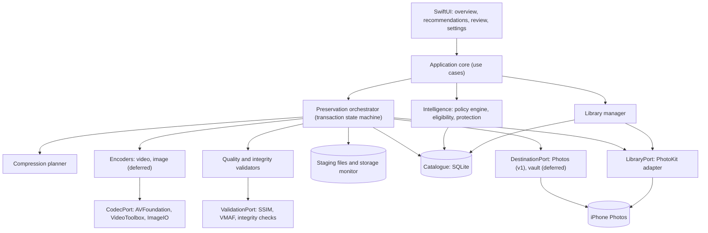
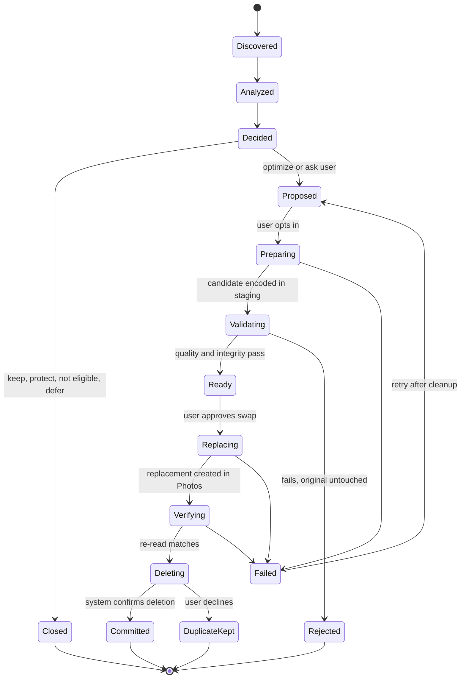

# Architecture

Status as of 2026-11-06. The destination model is hybrid, per
[ADR-0002](adr/0002-preserved-output-destination.md).

## High-level design

Data flow for one item:

1. The adapter enumerates assets into `MediaAsset` records in the catalogue.
2. The policy engine reads each record and the protections, and produces a `PreservationDecision`
   with an explanation.
3. The UI shows recommendations. The user opts in to prepare candidates.
4. The orchestrator opens a transaction. The planner picks the encoding and the storage monitor
   checks the staging budget.
5. The encoder writes a candidate to staging. Validators check quality and integrity.
6. The user approves the validated candidates. The destination places the replacement in Photos,
   the adapter verifies it and requests deletion of the original (a system prompt), and the
   catalogue commits.

## Layers

The core is pure Swift behind protocols ([ADR-0001](adr/0001-ports-and-adapters.md)) and its tests
run on Windows. Adapters import Apple frameworks and compile only on CI.

## Classes

| Class | Responsibility | Layer |
|---|---|---|
| `MediaAsset` | Immutable technical snapshot of one item. It never holds an invented "last viewed". | core |
| `PreservationDecision` | Outcome, reason codes, risk, expected savings, quality tier, approval flag, policy version. | core |
| `EligibilityRules` | Pure technical gate: supported format, HDR/Live Photo/ProRes handling, worth-touching size, already efficient. | core |
| `PreservationPolicyEngine` | Composes protection, eligibility, efficiency, savings, uncertainty and staging into one explained decision. Protection short-circuits everything. | core |
| `CompressionPlanner` | Picks encoder settings per item, or a candidate ladder if control is bitrate-only. Routes the output to a destination. | core |
| `QualityPolicy` | Pass or fail from metrics and content type. Fail-closed, versioned, calibrated in the lab. | core |
| `PreservationTransaction` | Persisted state and side-effect record per item, for crash recovery and idempotency. | core |
| `PreservationOrchestrator` | Drives transactions one item at a time, resumable, with retry and cleanup. | core |
| `MediaLibraryManager` | Discovery, incremental change tracking, catalogue sync. | core |
| `PhotoLibraryAdapter` | PhotoKit: authorization, enumeration, metadata (absorbs the metadata extractor), reading assets, deletion requests. | Apple |
| `PhotosDestination` | Creates the replacement in Photos with date, location, favourite and albums. `VaultDestination` is deferred. | Apple |
| `VideoCompressionEngine` | HEVC encode to staging, cancellable, with progress. | Apple |
| `ImageCompressionEngine` | Deferred until Experiment 0 shows photo savings. | Apple |
| `QualityAssessmentEngine` | SSIM, and VMAF if affordable, on sampled or full frames. | Apple |
| `IntegrityValidator` | Full decode, duration, tracks, dimensions, color and HDR flags, checksum. | Apple |
| `StorageMonitor` | Free space and staging budget. It refuses work that could exhaust storage. | Apple |
| `SqliteCatalogueStore` | SQLite for assets, decisions, transactions, quality, protections and audit log. | Apple |

The constitution's `ThumbnailManager`, `MediaVaultRepository` and `RestorationEngine` exist only
once a vault does ([ADR-0002](adr/0002-preserved-output-destination.md)).

## Preservation lifecycle

- State is persisted before every side effect. On launch the orchestrator resumes or rolls back:
  staging files with no transaction are deleted, an unknown `Replacing` outcome is checked by
  looking up the stored `localIdentifier`, and an unknown `Deleting` outcome is checked by testing
  whether the original still exists.
- The only irreversible step is the deletion confirmation, and it comes only after verification.
- The user has three touchpoints per batch: opt in to prepare, approve validated candidates, and
  the system delete prompt (once per batch, to be confirmed by spike E4).
- Space returns only when Recently Deleted is purged (Reported), and the app cannot purge it. The
  UI must say so.
- Declining the delete prompt leaves a duplicate. Removing it needs another prompt (unverified).
- With a vault there is an extra `Vaulted` state.
