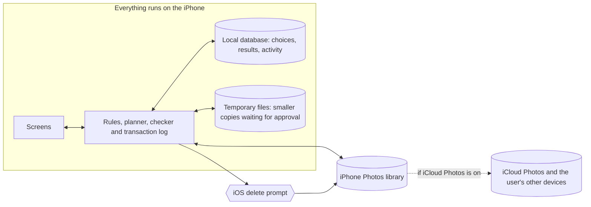
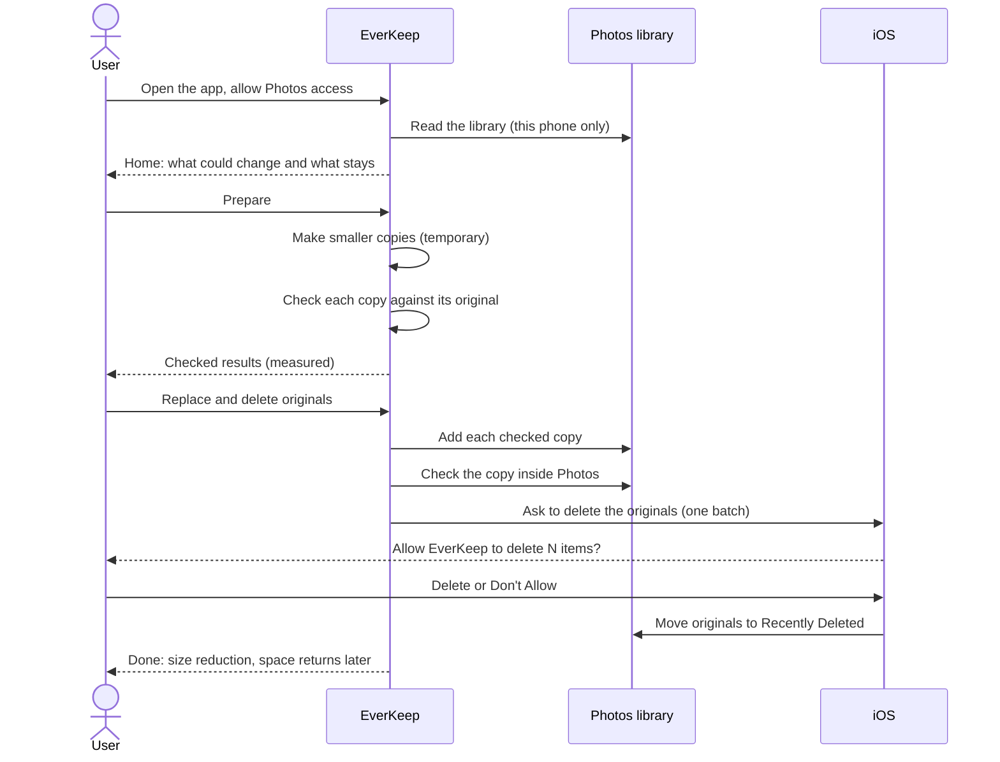
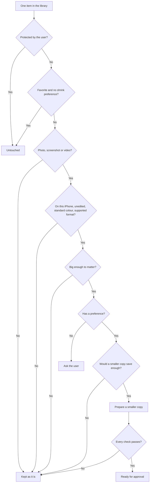
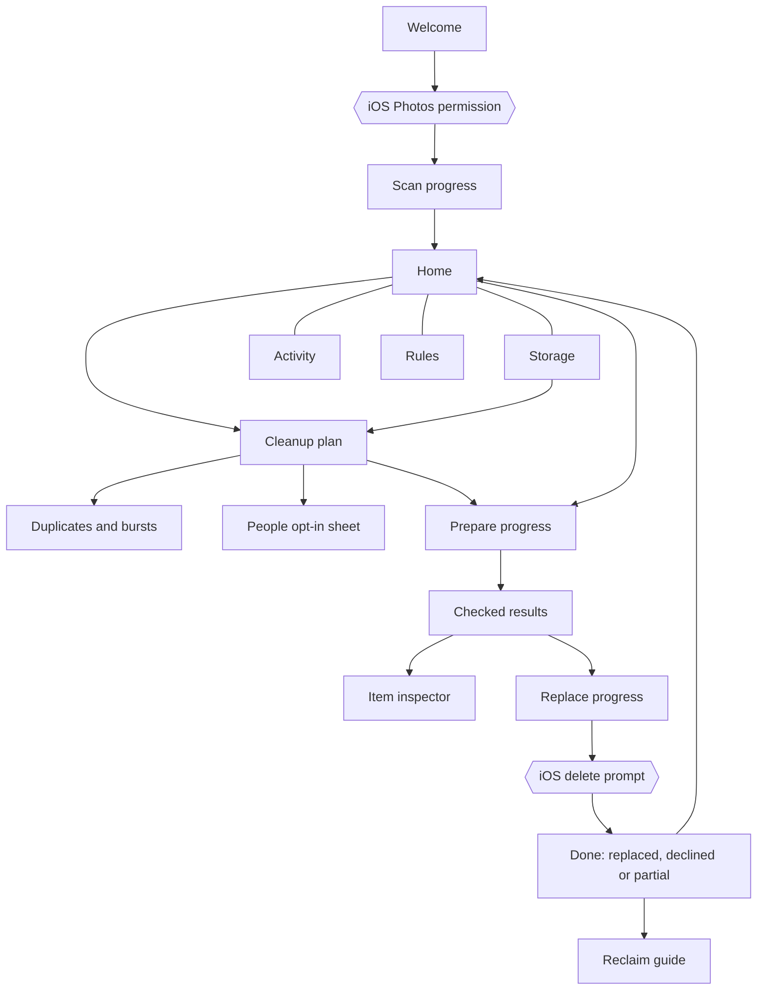
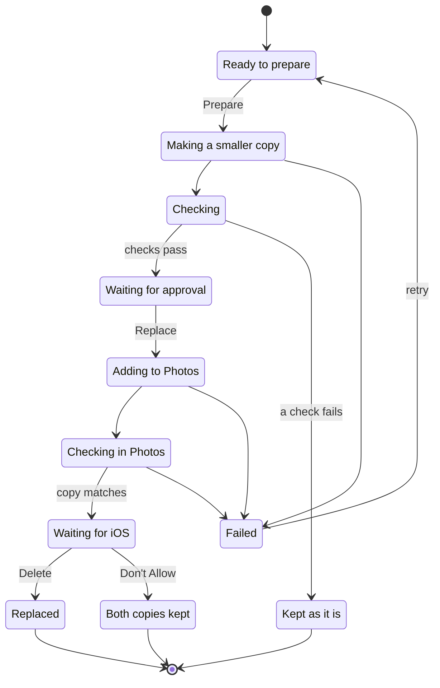

# EverKeep: product architecture and behavior spec

**For:** the UX/UI designer. **Prepared:** 2026-11-07. **Product name:** EverKeep is a working name, and other App Store apps already use it. Design without a final logo or wordmark.

> **Confidential.** This describes the decision rules: what is kept, shrunk or deleted. Share it only under an NDA.

This document says what the product does, in what order, under which rules and in which states. It stays at behavior level: no codecs, thresholds, quality metrics or class names. **The user** is the person whose photos are processed. **The product owner** makes the decisions listed in section 12.

**Status labels**

| Label | Meaning |
|---|---|
| Written | Code exists in the Swift app. It has never been run on a Mac or an iPhone. |
| Designed | Exists only in the HTML previews. Not in the Swift app. |
| Proposed | Exists only in this document. Needs a product owner decision and engine work. |

**Evidence labels.** *Verified*: read in this project's code on 2026-11-07. *Reported*: from Apple documentation or press, not re-checked here. *Hypothesis*: an inference that still has to be tested. *Judgment*: a recommendation, not a fact.

**Mockup rule.** Every number in the previews is invented. Do not publish mockups that show savings figures. Savings are unproven until the first lab experiment passes (flag G).

---

## 1. The product in one page

**What it is.** An iPhone app that makes a photo and video library smaller without asking the user to decide item by item. It finds extra shots, shrinks what is safe to shrink, leaves people and favorites alone, checks every smaller copy against its original, and replaces an original only after the user approves. Everything runs on the phone. There is no account, no cloud and no subscription.

**Working promise.** Free up space. Keep every memory.

**Who it is for.** iPhone users whose storage is full and who do not want to delete memories or pay monthly for more. First market: India. *Reported:* iPhones were about 7 to 8.5 percent of India's smartphone shipments in Q2 2026.

**The moment it enters.** The "iPhone Storage Almost Full" warning.

**The design problem.** A destructive, high-trust, slow operation on the user's most personal files has to feel light: few questions, strong guardrails, honest numbers.

**Form.** iPhone only, portrait only, iOS 16 or later. *Verified* in the project settings.

---

## 2. Read this first: seven things that change the design

These came out of reading the code against the redesign. Each one changes what a screen can honestly show.

### A. File sizes are unknown until each item is opened

- **Evidence.** *Verified.* The library read sets every file size to zero, because PhotoKit has no public size property. A size is read only when an item is analyzed, and analysis starts only after the user has chosen a preference for that item.
- **Design impact.** Home's storage bar, the per-folder savings and "Largest items" cannot be filled right after a scan. They need a sizing pass over every original. That pass is slow and unmeasured, so it has to show progress and fill the numbers in progressively. It also has to resume: *Verified*, today a scan saves its results only when the whole scan finishes, so an interrupted scan starts over.
- **Needed.** Choose the data source. Time a full pass on a real library.

### B. Most of a modern iPhone library may be excluded

- **Evidence.** *Verified:* HDR and wide-colour photos and videos are never changed. The photo check treats any wide-gamut colour space as excluded, and Display P3 is one. *Reported:* iPhone 7 and later capture photos in Display P3. iPhone 12 and later record HDR (Dolby Vision) video by default. *Hypothesis:* on newer iPhones most photos and videos land in "Kept as they are".
- **Design impact.** "Kept as they are" may be the biggest group on Home. Design a calm, useful state for "most of your library is untouched, and here is why", and for very small savings.
- **Needed.** Measure the excluded share on three to five real libraries before Home is finalised.

### C. Originals that live only in iCloud are skipped

- **Evidence.** *Verified.* The app reads originals only from the phone. Network access is off, so a cloud-only item is reported, never downloaded.
- **Design impact.** Users with "Optimize iPhone Storage" may see a large "Not stored on this iPhone" group. Version 1 has no download-first path.
- **Needed.** Decide whether a later version offers "download originals first".

### D. A swap adds first, deletes second, and the space comes back late

- **Evidence.** *Verified* order: each smaller copy is added to Photos and checked there, and only then is one batch deletion requested. Prepared copies wait in temporary storage until approval. The app refuses to prepare a copy if free space would fall below a safety reserve. *Reported:* deleted items sit in Recently Deleted, and the app cannot empty it.
- **Design impact.** On a nearly full phone the flow can stall at the first step, and the library grows before it shrinks. The design needs a "free a little space first" state, a plan that can run in chunks, and a Reclaim step after Done (section 6.4).
- **Needed.** Spikes E4 and E5 (planned simulator tests of the delete prompt, Recently Deleted and when space returns; not started). A chunking rule.

### E. Category rules conflict with a written rule

- **Evidence.** *Verified.* Today an item with no preference always asks. A UI test asserts "unassigned items must never become candidates automatically". The requirements say content classification never assigns personal importance, and the README says the app never chooses a destructive preference from age, faces or motion.
- **Design impact.** The redesign's category switches are on by default, so they assign preferences. The product owner approved "minimal choices, approve in bulk" on 2026-11-06, but no decision record captures it and that test would fail.
- **Needed.** A decision record. Option A: the switches count as the user's explicit choice and are shown once before the first Prepare. Option B: defaults on, reviewed on the plan screen. The screens differ.

### F. Deleting duplicates is a new kind of action

- **Evidence.** *Verified.* The engine only replaces: smaller copy first, then the original. It has no "delete without replacement", no duplicate finder and no burst grouping. *Reported:* PhotoKit returns one representative per burst unless asked for all of them.
- **Design impact.** Duplicate groups are the most destructive-looking part of the product. They need the strongest review pattern and a "Keep all" exit.
- **Needed.** A decision record and engine work.

### G. Savings figures are not allowed yet

- **Evidence.** *Verified.* Requirement F6: no savings figure in any UI, post or pitch until the first lab experiment (Experiment 0, which asks whether real videos shrink enough at matching visual quality) supports it. It has not been run. The redesign shows approximate amounts because the product owner asked for them on 2026-11-06.
- **Design impact.** Treat every savings number as a component with three states: hidden, estimate, measured (section 8.1).
- **Needed.** Decide what the first build shows. *Judgment:* measured results after a real replace are facts and can ship. Estimates before a replace are the open question.

---

## 3. Principles that bind the design

| # | Principle | What it means on screen | Source |
|---|---|---|---|
| 1 | Unused is not unimportant | No "old", "rarely opened" or "forgotten" lists or labels. Age, recency and viewing history never drive a decision. | Product constitution, ADR-0006 |
| 2 | The user stays in control | Nothing changes without an explicit approval. Protection always wins. Favorites are protected by default. | Requirements |
| 3 | Preserve first, fail closed | If a check is missing or unsure, the original stays. A failed check is a calm, normal outcome, not an error. | ADR-0004 |
| 4 | The original is touched last | Only after a checked smaller copy exists inside Photos, and only after approval and the iOS prompt. | ADR-0002, ADR-0003 |
| 5 | Photos is the only library | No gallery, vault, restore or export screen in version 1. Browsing stays in Photos. | ADR-0002 |
| 6 | Local first | No account, cloud, subscription, ads or analytics. *Verified:* the app contains no networking code today. | Requirements |
| 7 | Honest numbers | File-size reduction, not "space freed". Amounts, never percentages. Estimates are marked. Measured results are labeled as measured. | Product owner, 2026-11-06 |
| 8 | Few questions | Defaults decide. The user approves in bulk. | Product owner, 2026-11-06 |

---

## 4. Product architecture

### 4.1 The system at a glance

Screens are SwiftUI. The brain is plain Swift with no Apple frameworks, so it can be tested without a phone. The phone services (Photos, the image and video frameworks, Vision, SQLite) sit behind it.

### 4.2 What happens, in order

### 4.3 Capabilities

| # | Capability | What the user gets | Status |
|---|---|---|---|
| 1 | Read the library | Photos and videos on this phone are listed, with the user's permission. | Written |
| 2 | Sort into groups | Duplicates and bursts, Screenshots, Scenery and everyday, People as the subject, Favorites, Kept as they are. | Partly written. The screenshot flag, favorites and the exclusions exist. Duplicate finding and "person is the subject" do not. |
| 3 | Show what uses space | A breakdown by type and a list of the largest items. | Designed. Needs a sizing pass (flag A). |
| 4 | Estimate savings | An approximate amount before anything is prepared. | Proposed (flag G) |
| 5 | Prepare smaller copies | One item at a time, in temporary files. A gentler setting is tried if a stronger one fails the checks. | Written |
| 6 | Check each copy | Compare with the original before anything is offered for approval. A missing or unsure check fails. | Written. The pass marks are not yet calibrated. |
| 7 | Review and approve | See checked results, inspect original against copy, approve once. | Inspect: Written. Results screen: Designed. |
| 8 | Replace in Photos | Add the copy with the same date, location, favorite flag, file name and albums, then check it inside Photos. | Written. After the swap the date, duration, dimensions and previews are verified. Location, favorite flag and albums are not. |
| 9 | Ask iOS to delete originals | One system prompt per batch. | Written. The prompt count is not yet verified on a device. |
| 10 | Delete extra shots | Remove duplicates without replacing them. | Designed. Not in the engine (flag F). |
| 11 | Protect | Keep an item exactly as it is. | Written per item. By rule: Designed. |
| 12 | Resume | Roll back or finish after a crash or kill, without ever deleting an original. | Written. Never exercised on a device. |
| 13 | Guard free space | Refuse work that could exhaust storage. | Written |
| 14 | Activity log | A record of what happened. | Written, in technical wording. |

### 4.4 What the app stores

- **On the phone, in a local database:** for each item its kind, dimensions, duration, favorite flag, whether the original is on the phone, whether it is edited or special, and its file size once known. Also the decision and its reasons, the user's preference, protections, every attempt (state, notes, check results) and the activity log.
- **Temporary files:** smaller copies waiting for approval live in a staging folder that is excluded from backups. They are removed after approval, rejection or discard.
- **Never stored:** copies of photos beyond those temporary files, thumbnails, the words in an image, or who is in a photo. Text and face checks run on the phone. They compare before and after, and the database keeps only yes-or-no hints such as "contains text" and "contains a face".
- **Never sent:** nothing leaves the phone. *Verified:* no networking code exists in the app today.

---

## 5. Items and decisions

### 5.1 What is in a library, and what version 1 does with it

| Kind | Version 1 treatment | Where it lands in the redesign |
|---|---|---|
| Photo (JPEG, PNG, HEIC), standard colour | Can be shrunk. Dimensions are kept. | Scenery and everyday shots, or People |
| Screenshot | Can be shrunk with extra care for text. PNG is tried lossless first. Transparent images stay PNG. | Screenshots |
| Video (H.264 or HEVC), standard dynamic range | Can be shrunk. Frame rate and audio are kept. Space first may reduce to 720p unless text is detected. | Scenery and everyday shots, or People |
| Live Photo | Kept. The pairing is not validated yet. | Kept as they are |
| HDR or wide-colour photo or video | Kept (flag B). | Kept as they are |
| Slow motion, time-lapse, cinematic or spatial video | Kept. | Kept as they are |
| RAW, depth or portrait data | Kept. | Kept as they are |
| Edited item | Kept. A replacement would flatten the edits. | Kept as they are |
| Original not on this phone | Kept (flag C). | Kept as they are |
| Unsupported format | Kept. | Kept as they are |
| Very small item | Skipped. Not worth changing. | Kept as they are |
| Item that is already efficient | Skipped. | Kept as they are |
| Favorite | Protected, unless the user explicitly chose a shrink preference for that item. | Protected |

### 5.2 What happens to one item

### 5.3 From per-item preferences to category rules

The written app gives each item one of four preferences: **Protected** (keep exactly), **Almost identical** (keep resolution and frame rate, stricter checks), **Space first** (videos may drop to 720p, photos keep their dimensions) or **Unassigned** (ask). The redesign replaces choosing per item with category rules that fill in preferences in bulk.

| Category | Default for items in it | What the user can change | Engine today |
|---|---|---|---|
| Duplicates and bursts | Keep the best shot, delete the extras | A switch for the category. Tap another shot to keep it. Keep all in a group. | No. New action (flag F). |
| Screenshots | Shrink. Words must stay readable. Skip QR codes and barcodes. | A switch | Shrink with text care: Written. Barcode skip: not written. |
| Scenery and everyday shots | Save more: videos may drop to 720p, photos keep their dimensions. | A switch, and Keep quality or Save more | Both preferences exist per item. The category is new. |
| People as the subject | Untouched | Opt in to gentle shrinking (Almost identical) | Protected exists. Deciding who is the subject does not: today a detected face is only a hint. |
| Favorites | Always protected | Nothing in the redesign. The written app lets the user override per item. | Written, with override |
| Kept as they are | Never touched | Nothing | Written |

**Precedence**

Written today:

1. The user's explicit protection wins over everything.
2. Technical exclusions win over any preference.
3. A bulk assignment never overrides an item that already has a preference, and never touches protected items.

Proposed for the category rules:

4. People as the subject is decided before Scenery, so a photo is never in both.
5. In a duplicate group, extras can be deleted even when people are in the picture. The kept shot stays untouched. *Confirmed by the product owner, 2026-11-06.*
6. *Judgment:* when it is unclear whether a person is the subject, treat the photo as a person photo. Fail toward protection.

### 5.4 What "checked" means

- **Pictures.** The smaller copy is compared with the original at full size and at thumbnail size, so Photos' grid still looks right. Colour is compared too.
- **Text.** Words in the image are read before and after and must match.
- **Faces.** Face areas are compared separately.
- **Video.** Every frame must decode. Duration, frame rate, audio tracks and colour tags must match. A sample of frames is compared visually.
- **Size.** The copy must actually be smaller by a worthwhile margin.
- **Inside Photos.** After the copy is added, Photos' own previews are compared with the original's, and the dates must match.
- **Any missing or inconclusive check is a fail.** The original stays.
- **A stronger shrink that fails is retried gentler** before the item gives up. This is why results can differ from estimates.
- **Limits.** The visual checks sample frames. They do not prove that every moment is unchanged, and the pass marks are not yet calibrated against real footage. So the UI must never claim lossless, identical or invisible loss.

---

## 6. The journey

### 6.1 Navigation map

Proposed tab bar: Home, Storage, a central Cleanup action, Activity, Rules.

### 6.2 Stages

| Stage | The user | EverKeep | Duration |
|---|---|---|---|
| 1 Open | Sees the promise | Shows Welcome | Seconds |
| 2 Allow | Allows Photos access | Reads the library only after this | Seconds |
| 3 Scan | Waits, and may leave | Lists items, reads sizes, finds extra shots and people | Unmeasured. Minutes or more on large libraries. |
| 4 Understand | Reads Home, may open Storage | Shows what could change and what stays | Seconds |
| 5 Tune | Optional: flips a category, picks Keep quality or Save more, reviews duplicate groups | Recalculates the amounts | Seconds |
| 6 Prepare | Taps Prepare and waits | Makes and checks smaller copies, one at a time | Unmeasured. *Hypothesis:* hours for many large videos. |
| 7 Approve | Reads Checked results, taps Replace and delete originals | Adds copies to Photos, checks them there, requests deletion | Minutes |
| 8 iOS prompt | Taps Delete or Don't Allow | iOS moves originals to Recently Deleted | Seconds |
| 9 Reclaim | Empties Recently Deleted in Photos, or waits | Shows what is waiting and can re-check free space | Until Recently Deleted is emptied or its retention ends |
| 10 Return | Comes back later | Scans for new items and shows what is new | Seconds to minutes |

### 6.3 The question budget

| Moment | Asked by | Required | Purpose |
|---|---|---|---|
| Allow Photos access | iOS | Yes | Read and write the library |
| Prepare | EverKeep | Yes | Opt in to spending time and battery (stage 1) |
| Replace and delete originals | EverKeep | Yes | Approve the checked results (stage 2) |
| Delete N items | iOS | Yes | The system's own confirmation (stage 3) |
| Allow gentle shrinking of people photos | EverKeep | Only if the user wants it | Explicit consent |
| Category switches, Keep quality or Save more | EverKeep | No. Defaults decide. | Tuning |
| Keep another shot, or Keep all, in a duplicate group | EverKeep | No | Override |

**Target:** after the permission, three required taps: Prepare, Replace, Delete. Nothing else may block that path.

### 6.4 Reclaim: the step after Done

After Done, the originals sit in Recently Deleted. The user's free space does not change until Recently Deleted is emptied (Photos, Albums, Recently Deleted, Select, Delete All) or its retention window ends (30 days, *Reported*). The app cannot empty it and cannot read how much is in it. The Reclaim guide therefore:

- shows the amount the app itself deleted, labeled as coming from its own activity,
- gives the steps to empty Recently Deleted in Photos,
- offers "Check again", which compares free space now with free space before the run,
- never promises a time.

---

## 7. Screens

Each card says what the screen is for, what it shows, what the user can do, which states it needs, and where it stands. "Written" names the nearest screen in the Swift app.

### S1. Welcome (Designed)

- **Purpose.** Say what the app does and why it is safe, in one breath. One action.
- **Shows.** The promise. One privacy line: everything stays on this iPhone, nothing changes until the user approves. A "How it works" link. The action "Scan my library".
- **Rules.** No sign-up, account or price. Photo access is not requested until the action is tapped (*Judgment*).
- **States.** First launch only. Later launches open Home.
- **Written.** None. The app opens on the Overview tab.

### S2. Photos access (system dialog plus app states)

- **Purpose.** Get Full access and explain what happens when the user gives less.
- **System-owned.** The iOS dialog. The app controls only its two usage-description strings and everything around the dialog. Today's strings say "photos and videos you choose to optimize", which no longer matches category rules.
- **States.** Not asked. Full access. Limited (selected photos only). Denied. Restricted (parental controls or device management).
- **Rules.** Limited access can scan the selected items, but totals and duplicate checks are then incomplete: explain it and offer "Allow full access" (*Judgment:* require Full access for the plan). Denied and Restricted: explain, and offer the Settings page.
- **Written.** Status text "Photo access is needed. Allow it in Settings."

### S3. Scan progress (Designed)

- **Purpose.** Reassure during a long first pass.
- **Shows.** Steps (Reading your library, Sizing items, Finding extra shots, Looking for people), real counts ("3,420 of 8,412 items"), and the line "Everything stays on this iPhone".
- **Actions.** Cancel keeps the partial results. Leaving the app stops the scan. Today a scan saves its results only at the end, so it starts over (flag A). *Proposed:* save as it goes, so scanning again picks up where it stopped.
- **States.** Running, paused, cancelled, interrupted, some items failed to analyze (counted, originals unchanged).
- **Written.** One progress bar and a status line.

### S4. Home (Designed)

- **Purpose.** One glance: what could change, what uses the space, one clear next step.
- **Shows.** A headline amount (hidden, estimate or measured, per flag G) with a library ring. The primary action. A storage bar (Photos by type, everything else, free). Folders (Photos, Live Photos, Videos, Screenshots) with the potential saving of each. Recommendations (Duplicates and bursts, Screenshots, Scenery and everyday shots, People and favorites). A "Kept as they are" summary. A privacy shield.
- **Actions.** Prepare. Review plan. Open a folder or a row. Open the privacy sheet.
- **States.** Before the first scan. Scanning with partial numbers. Ready. Nothing to do ("Nothing left to clean"). After Done (a banner with the amount waiting in Recently Deleted, and the Reclaim guide). Loading skeleton. No access. Limited access. Mostly kept as they are (flag B).
- **Rules.** The headline is a file-size reduction, not free space (flag D). Live Photos appear only through duplicates. Apps and system storage cannot be split, so they are one block labeled "Everything else".
- **Written.** The Overview tab: counts, measured savings, a scan button.

### S5. Storage (Designed)

- **Purpose.** Answer "what is using my space, and what can be done about it".
- **Shows.** A donut of the library by type. A card per folder: size, item count, potential saving, and what the saving is made of. "Largest items", each with what will happen to it and why.
- **Rules.** Live Photos are not shrunk in version 1, only duplicates are removed. An item that will not change says why, using the reason library (appendix B).
- **Needs.** A sizing pass (flag A).

### S6. Cleanup plan (Designed)

- **Purpose.** The one place where the user sees and tunes what will happen.
- **Shows.** The headline amount. A split of items into deleted extras, shrunk, untouched and kept as they are. A card per category: Duplicates and bursts, Screenshots, Scenery and everyday shots (with Keep quality or Save more), and People and favorites. A "Kept as they are" disclosure. The primary action "Prepare plan".
- **Actions.** One switch per category. The Keep quality or Save more choice. The people opt-in. Review groups. Prepare.
- **Rules.** Each card has exactly one switch. Preparing spends time and changes nothing. People stay untouched unless the user opts in. Defaults follow the decision on flag E.
- **Written.** The Preferences tab (per-item list) and its bottom bar ("Apply to unassigned", "Prepare N candidates").

### S7. Duplicates and bursts (Designed)

- **Purpose.** Let the user trust "keep the best, delete the rest" at a glance, and override it cheaply.
- **Shows.** Groups. Each has a title, why it is a group ("4 shots, 3 seconds apart"), and its shots tagged Keep or Delete, each with a reason (Sharpest, Favorite, In an album, Eyes closed) and a size. The total amount. "and N more groups".
- **Actions.** Tap another shot to keep it. Keep all for a group. Done.
- **Rules.** *Proposed:* the kept shot is a favorite, an edited photo or one in an album first, then the sharpest. Extras are deleted only after approval. A favorite is never auto-deleted. Never offer "select all" without showing the grouping.
- **Needs.** The duplicate finder and delete-only action (flag F).

### S8. People opt-in sheet (Designed)

- **Purpose.** Explicit consent to include people photos in shrinking.
- **Shows.** What changes (saved again at high quality), that faces are compared with the original, and that any photo that fails stays as it is. "Allow gentle shrinking" and "Keep them untouched".
- **Rules.** Off by default. Reversible in Rules.

### S9. Prepare progress (Designed)

- **Purpose.** Reassure during the longest step.
- **Shows.** A step list (Choosing the best shot, Shrinking screenshots, Shrinking videos and photos, Checking every result), a ring with "Step n of N", the line "Your originals are untouched", and Cancel.
- **Rules.** One item at a time. Time is unknown, so do not show a countdown. Show counts instead ("212 of 640"). Leave and resume. May not start on a nearly full phone (flag D).
- **States.** Running, paused, cancelled (keeps ready results), partly complete, interrupted, not enough space.
- **Written.** A status line such as "Encoding 40%".

### S10. Checked results (Designed)

- **Purpose.** The approval screen: the measured result, what will happen, one approval.
- **Shows.** The measured amount, labeled "Measured after checking every item", and the earlier estimate. Per category, "passed N of M" and an amount. A callout for items that stay exactly as they are. "What happens next" in three steps. The full disclosure (section 8.3). The primary action "Replace and delete originals". The secondary action "Discard results".
- **Actions.** Open an item to compare (S17). Protect instead. Discard.
- **Rules.** This screen carries the full disclosure. There is no second confirmation sheet, because the iOS prompt is the second. Counts reconcile: prepared equals passed plus kept.
- **Written.** The Review tab (per-item list, similarity numbers, a confirmation dialog). Replace those numbers with plain words.

### S11. Replace progress (Designed)

- **Purpose.** Hold the user through the add, check and request steps.
- **Shows.** Steps: Adding smaller copies to Photos, Checking each copy in Photos, Preparing the delete request.
- **Rules.** While this runs, the library temporarily holds both copies. Cancel is available only before the delete request. Frame the iOS prompt that follows.

### S12. iOS delete prompt (system-owned)

- **What iOS shows.** A system alert that names the app and the number of items, with a delete button and a "Don't Allow" button. The wording belongs to iOS and can change between versions. The preview imitates it ("Allow "Everkeep" to delete N items?"). It cannot be restyled or skipped.
- **Design job.** Prepare the user on S10 and S11. Explain the outcome on S13.
- **Open.** The number of prompts per run is unverified (spikes E4 and E5). Design for one, and tolerate several.

### S13. Done (Designed)

- **Replaced.** The measured reduction. "Waiting in Recently Deleted". A link to the Reclaim guide. Back to Home.
- **Declined.** "Nothing was deleted. Smaller copies were added next to your originals, so they use extra space until the originals are deleted." Offer to finish from Checked results.
- **Partial.** Three counts: replaced, both copies kept, failed. List the exceptions and where each stands.
- **Rules.** Never present space freed as a fact. Say size reduction, and explain the Reclaim step.

### S14. Reclaim guide (Proposed)

- **Purpose.** Close the loop. The space is not back until Recently Deleted is emptied.
- **Shows.** What the app deleted (from its own activity), the steps in Photos, and "Check again".
- **Rules.** No promised time. No claim about what is in Recently Deleted beyond the app's own records. A direct link into the Recently Deleted album is *Hypothesis*: probably not possible.

### S15. Activity (Designed)

- **Purpose.** A plain-language record of everything the app did.
- **Shows.** Entries newest first: what happened, how many items, when.
- **States.** Empty ("No activity yet", with a Scan action).
- **Rules.** No raw errors. Offer "Copy details" for support (*Proposed*).
- **Written.** The Activity tab. Entries use technical names such as `preference.protected`, `analysis.failed` and `deletion.blocked`. They need human wording.

### S16. Rules (Designed)

- **Purpose.** Change the category rules at any time.
- **Shows.** The same switches as S6. Read-only rows for People as the subject and Favorites. A note that amounts are estimates until measured.
- **Rules.** Stays in sync with the plan switches.

### S17. Item inspector (Written)

- **Purpose.** Compare the original and the smaller copy before approving.
- **Shows.** A Candidate or Original toggle. Photos zoom with a pinch, up to six times. Videos play with sound. A caption: "This is a review preview, not a separate saved gallery."
- **Actions.** Done. Protect instead.
- **Rules.** Opened from S10 and from the Kept as they are lists. Thumbnails come from Photos itself.

### S18. Item detail: why was this kept? (Proposed)

- **Purpose.** Transparency for any single item.
- **Shows.** Thumbnail, date, kind, size, the current treatment and the reason in plain words (appendix B). A per-item control: Protect, or allow shrinking (Almost identical, Space first).
- **Rules.** Never required. It is the escape hatch for users who want control, and the home of what the written Preferences tab does today.

### S19. Privacy sheet (Designed)

- **Shows.** Scanning, duplicate and face checks run on this iPhone. Nothing is uploaded and there is no account. Face checks only say whether a person is present, never who. Originals are replaced or deleted only after approval, and every smaller copy is checked first. Deleted items stay in Recently Deleted for 30 days (*Reported*).
- **Rules.** Every statement must stay true. Re-verify each one before release.

### S20. Blocking states

Not enough space. Local database unavailable. Interrupted run. No access. Each states what happened, that nothing was changed, and the one next step. Today's copy for the database case ("The persistent catalogue is unavailable. Restart the app before optimizing.") needs plain wording.

---

## 8. Numbers, language and tone

### 8.1 Numbers

- **Three states.** Every savings number is one of: **hidden**, **estimate** ("about", with a leading "~"), or **measured** (no "~", labeled "measured after checking every item"). Ship the state the evidence allows (flag G).
- **Never percentages.** The product owner's reason: "500 MB video 15% saved" is hard for a user to calculate. Say "about 130 MB smaller".
- **Say reduction, not "freed".** Until the Reclaim step confirms it (flag D).
- **Units.** Decimal units, like iOS Storage. One decimal for GB. Whole MB from 10 MB up.
- **Reconcile.** Prepared equals passed plus kept. Items on Home equal the sum of the groups.
- **Dates and times.** Use system formats.

### 8.2 Vocabulary

| Use | Avoid | Why |
|---|---|---|
| smaller copy | compressed file, optimized version | Plain language |
| original | source, raw | Plain language |
| Recently Deleted | bin, trash | The iOS name |
| Photos | gallery, camera roll | The iOS name |
| shrink | compress, optimize | Plain language. The written app says "optimize" and "preserve". |
| extra shots | duplicates, in running text | Warmer. "Duplicates and bursts" is fine as a heading. |
| checked | verified, guaranteed, lossless, identical | No claim of invisible loss (section 5.4) |
| about 130 MB smaller | 15 percent smaller | Product owner decision |

**Open.** "Cleanup", "clean up" and "free up" are cleaner-app language. The X strategy positions the product as "keeping memories, not managing storage". Decide which vocabulary the app uses.

### 8.3 Trust moments: must say, must not say

| Moment | Must say | Must not say |
|---|---|---|
| Before the Photos prompt | What is read. That nothing leaves the phone. That nothing changes without approval. | Alarm or urgency ("Your storage is full!") |
| Approval screen (S10) | Counts and amounts per group. What stays untouched. That originals go to Recently Deleted and wait there. That iCloud Photos carries the change to other devices. That original quality cannot be restored after permanent deletion. That iOS asks once more. | free, undo, restore, safe, lossless, identical, guaranteed |
| Before the iOS prompt | That the next prompt comes from iOS | Anything that contradicts the prompt |
| Declined | Nothing was deleted. Both copies exist and use extra space. How to finish. | Blame or a red alarm |
| Partial failure | Three counts and where each item stands. That originals are untouched. | Raw errors |
| People opt-in | What changes. That faces are compared. That failures stay as they are. | "No visible change" |
| Duplicates | Why each shot is kept or deleted | Auto-selecting without showing the rule |

---

## 9. Platform facts the design cannot change

| Fact | Consequence for design | Evidence |
|---|---|---|
| iOS shows its own delete confirmation. It cannot be skipped, restyled or pre-filled. | Frame it before, explain it after (S11, S13). | *Reported.* The UI test drives it. |
| Deleted items go to Recently Deleted. The app can neither empty nor read it. | A Reclaim step. No "space freed" claims. | *Reported* |
| iCloud Photos carries the replacement and the deletion to the user's other devices. The app cannot reliably tell whether iCloud Photos is on. | Copy is conditional: "If iCloud Photos is on...". | *Reported.* The second sentence is a *Hypothesis*. |
| Photos keeps no general "last viewed" time. | No "unused" features. | *Verified* in Apple documentation, 2026-11-05 |
| The Apps and System share of device storage is not available to apps. | One block, labeled "Everything else". | *Reported* |
| Device total and free capacity are available. | The storage bar can show used and free. | *Reported.* Free space is read today. |
| Background work is scheduled by iOS and can be interrupted. The app has no background code and does not keep the screen awake. | Foreground only. Leave-and-resume copy. Pause on interruption. | *Verified* in code and in Apple documentation |
| Photos access is Full or Limited. | Limited gives partial totals. | *Verified:* the code reads both. |
| A replacement is a new item with a new identifier. | Shared albums, Memories and other apps may treat it as new. Make no promises. | *Hypothesis.* Planned fidelity tests. |
| Real-device testing needs the paid Apple Developer Program. No timing, battery or heat has been measured. | Do not finalise durations, or motion tied to them. | *Verified* in the project docs |
| App Review may look hard at bulk replace-and-delete. | Honest copy and explicit approvals. | *Reported* |

---

## 10. Failure and edge states

| Situation | The user sees | What stays safe | Offer |
|---|---|---|---|
| Access denied or restricted | An explanation, no scan | Nothing is read | Open Settings |
| Limited access | A partial-library notice | Nothing changes | Allow full access |
| Nothing to shrink | "Nothing to shrink, and here is why", with the Kept as they are breakdown | Everything | Review the kept items |
| Scan cancelled or interrupted | Partial results | Nothing changes | Resume or scan again |
| Not enough free space to prepare | How much is needed against what is free | Nothing changes | Free a little space, or prepare fewer items |
| A copy fails the checks | It counts in "stay exactly as they are" | The original | Inspect, or Protect |
| An item errors while preparing | Counted as failed with a plain reason | The original | Retry |
| App closed or killed mid-run | On the next launch: what was rolled back or resumed | Recovery never deletes an original | Continue |
| The original changed after preparing | "Prepare again" for that item | The original | Prepare again |
| A preference changed after preparing | That item's copy is discarded | The original | Prepare again |
| The check inside Photos failed after the copy was added | Both copies exist, flagged | The original | Remove the extra copy (needs another iOS prompt; *Proposed*) |
| The iOS prompt was declined | Both copies exist and use extra space | The original | Finish later from Checked results |
| Deletion partly succeeded | Counts: replaced, both kept, failed | The originals not deleted | Review the exceptions |
| Local database cannot open | Optimization is disabled | Nothing changes | Restart |
| Low battery, Low Power Mode or heat | Not handled today | Not applicable | Pause with a message (*Proposed*) |
| Phone locked or app in the background mid-run | The run pauses | State is saved | Resume on return |

---

## 11. Out of scope for version 1

- A private vault, a gallery, restore or export. Photos is the only library.
- An account, cloud, subscription, ads or analytics. There is no network code, so there are no usage numbers. Test with moderated sessions.
- Any rule based on age, recency or viewing history.
- Live Photos, HDR, wide-colour, RAW, depth, edited or special media.
- Downloading cloud-only originals.
- Background automation, widgets and notifications.
- iPad, landscape, Android.
- Localization. English first.

---

## 12. Open decisions and measurements

Ranked by how much they change the design.

| # | Decision or measurement | Blocks |
|---|---|---|
| 1 | Category rules against "unassigned must ask" (flag E) | Plan, Rules, the first-run path |
| 2 | Duplicate deletion as a new action (flag F) | Duplicates review |
| 3 | Which numbers the first build shows (flag G) | Home, Storage, Plan |
| 4 | The excluded share of real libraries (flag B). Measure first. | Home, empty states |
| 5 | The sizing pass: data source and time (flag A) | Scan, Home, Storage |
| 6 | Favorites: always protected, or overridable per item | Rules, S18 |
| 7 | Limited access: require Full access for the plan? (*Judgment:* yes) | S2, S4 |
| 8 | Vocabulary and positioning: "Cleanup" and "free up" against "keep" | All copy |
| 9 | Name and brand. The app display name is "Everkeep", the documents say "EverKeep". | Logo, wordmark |
| 10 | First-run path. *Judgment:* show the plan once before the first Prepare. | S4, S6 |
| 11 | A per-item escape hatch that is reachable but never required (*Judgment:* yes) | S18 |
| 12 | Prompt count and Recently Deleted behavior (spikes E4 and E5) | S11 to S14 |

---

## 13. What we need from design

1. **Flows.** Navigation and flow for sections 6.1 to 6.3, including every state in sections 7 and 10.
2. **Screens.** S1 to S20, in light and dark.
3. **A small component set.** Summary card, storage bar, folder chip, recommendation row, category card with a switch, duplicate group with Keep and Delete tags, results row, progress steps, banner and callout, bottom sheet, empty and skeleton states, and buttons (primary, secondary, tertiary).
4. **Copy** for the seven trust moments in section 8.3.
5. **Motion** for long-running steps and state changes, as a prototype only.
6. **A clickable prototype** for moderated testing with five users.

**How we will know it works** (*Judgment*). In a moderated test, a first-time user:

- says in their own words what will happen to their originals before tapping Replace,
- knows that people and favorites are untouched,
- can say when their space will actually come back,
- finishes with at most three required taps after the permission,
- does not believe anything was deleted without their approval.

---

## 14. What exists today

- **The written app.** The memory-replay design in SwiftUI, on the real engine. Source: `../app/Sources/UI/` (`ExperienceRoot.swift` is the entry; `DialView.swift`, `HomeScreen.swift`, `ReviewScreen.swift`, `Sheets.swift`, `Cards.swift`, `MemoryBackground.swift`, `Theme.swift`, and the model in `AppModel+Experience.swift`). It matches the redesign below screen for screen, with these honest differences: sizes come from a measuring pass over the real library; potential savings are estimates until the copies are made and checked; Live Photos are not optimized in version 1, so their savings read "None"; the before/after comparison shows a real smaller copy only after **Prepare**; favorites are never offered; photos with a person as the subject, or videos with fast movement, start left out until the person has taken a look; and a stopped scan returns to Welcome rather than showing partial results (§10), because the redesign has no place for a partial notice on the dial. Not built: duplicate and burst cleanup, Rules, Activity and Reclaim. The earlier four tabs (Overview, Preferences, Review, Activity) remain in Debug builds behind the launch argument `-EKClassicUI YES`, in `../app/Sources/UI/Views.swift`. A clickable mirror of those tabs with synthetic data: `../app/Preview/index.html`.
- **The redesign preview.** `../app/Preview/redesign.html`. A "memory replay" direction: Welcome, Scanning, a main screen that shows only the selected category, storage consumed, potential savings and **Review & preserve**, a review of the actual media (deselect, protect, and a "Look closer" before/after preview for items Everkeep is unsure about), Working, Checked, the iOS delete prompt and Done, plus the "How it works" sheet and a no-access state. The rotary dial is the only navigation. It replaces the earlier tab bar, Storage, Cleanup plan, Duplicates, Activity and Rules screens in the preview, so screens S5 to S7, S15 and S16 above describe the previous preview, not this one. Open the file in a browser. Add `?fast` to the address to speed up the progress steps. Synthetic data and sample photographs. A reference, not a requirement.
- **A visual system.** `../app/Preview/redesign.css` for the preview, and `../app/Sources/UI/Theme.swift` for the app. A faded, desaturated photograph as the atmosphere, translucent ivory glass in front of it, honey amber and muted gold for the one action, dark charcoal type, one quiet sage for "checked". The preview uses Instrument Serif for display and Geist for text; the app uses the system serif (New York) and SF Pro, with SF Symbols. `tokens.css`, `components.css` and `foundations.html` describe the previous violet system and are not used by `redesign.html`. The designer is free to depart from all of it.
- **Not yet run.** The Swift above was written on a machine without a Swift toolchain. It has been read and parsed, not compiled. Run the `app-simulator` and `app-e2e` workflows before relying on it.

**Copy in the redesign that over-promises today.** Fix these when finalising.

| Preview copy | Problem |
|---|---|
| "You can free up", "Free up space" | A reduction in library size, not device space (flag D) |
| "Smaller copies are added to Photos with the same date, place and albums." | The app sets them, but after a swap only the date is verified. Place and albums are not. |
| "Deleted items stay in Recently Deleted for 30 days." | *Reported.* Not yet verified for this app's deletions. |
| Any savings amount | Flag G |
| "Spotting chat screenshots" (a scan step) | All screenshots are treated alike. Chat detection was dropped. |
| "People and favorites stay untouched" | Rests on a "person is the subject" check that does not exist yet. Qualify it, or fail toward protection. |

---

## Appendix A. Item states

| Item state | The original | Notes |
|---|---|---|
| Ready to prepare, Making, Checking, Waiting for approval | Untouched | Only temporary files exist |
| Kept as it is | Untouched | Final. Counted in "stay exactly as they are". |
| Adding to Photos, Checking in Photos, Waiting for iOS | Untouched | Both copies exist from the moment the copy is added |
| Replaced | In Recently Deleted | Final. Space returns later. |
| Both copies kept | Untouched | Final. Extra space is used. Reached by declining the prompt or by a failed check inside Photos. |
| Failed | Untouched | May leave an extra copy if it failed after the copy was added. Can be retried. |

## Appendix B. Reasons an item is kept (existing copy)

This is the wording in the written app today. It is the source of truth for "why". Some lines need a plain-language rewrite.

| Reason | Shown to the user as | Note |
|---|---|---|
| User protected | You protected this item. | |
| Favorite protected | Favorites are protected. | |
| Not on device | The original is not stored on this device. | Flag C |
| Edited | It has edits that a replacement would flatten. | |
| HDR | HDR and wide-colour video is not supported yet. | Also applies to photos. Say so. |
| Special video | Slow motion, time-lapse, cinematic and spatial video is not supported yet. | |
| Unsupported codec | Its format is not supported. | |
| Unsupported kind | This kind of item is not supported. | |
| Special photo | RAW, depth and other special photo resources are not optimized yet. | |
| Live Photo | Live Photo pairing is not validated yet, so the original is kept. | |
| Too small | Too small to be worth changing. | |
| Already efficient | Already stored efficiently. | |
| Worth optimizing | Its bitrate is high enough to be worth preparing a candidate. | Technical. Rewrite. |
| Favorite, conservative | Favorite: the most conservative settings apply. | |
| Mode required | Choose Protected, Almost identical or Space first before optimization. | Replace with category rules |
| Space first selected | You allowed smaller video dimensions; frame rate and audio are preserved. | |
| Analysis incomplete | It has not been analyzed yet. | |
| Analysis failed | Analysis failed. The original is unchanged; see Activity for the error. | |
| Invalid media | The media's size, dimensions or timing could not be verified. | |
| Photos deferred | Photos are not optimized in this version. | Stale. Photos are now in scope. |

## Appendix C. Where each number would come from

| On screen | Source | Status |
|---|---|---|
| Items by type | Library read. Photos and screenshots are counted together. Live Photos are not counted yet. | Written, incomplete |
| Items by outcome | Decisions | Written |
| Candidates and their original size | Decisions. This is the original size, not a saving. | Written |
| Ready for approval | Transactions | Written |
| Replaced count and measured reduction | Committed originals minus the size of their smaller copies | Written |
| Why an item is kept | Reason codes (appendix B) | Written |
| Device free space | Read from the phone | Written |
| Device total capacity | Available to apps. Not read yet. | Proposed |
| Library size by type, largest items | Needs file sizes (flag A) | Proposed |
| Savings estimate | Needs an estimator. Photos are the hard case. | Proposed (flag G) |
| Duplicate groups and the best shot | Needs the finder (flag F) | Proposed |
| Person as the subject | A face is detected today. Who is the subject is not decided. | Proposed |
| QR code and barcode skip | Not written | Proposed |
| What is waiting in Recently Deleted | Not available. Derive it from the app's own activity. | Not available |
| Whether iCloud Photos is on | Not available (*Hypothesis*) | Not available |
| Activity in plain words | Mapping from technical events to wording | Proposed |

## Appendix D. Sources (internal; remove before sharing)

- `requirements.md`, `architecture.md`, `risks.md` and ADR-0001 to ADR-0007 in this folder.
- `../README.md` for the project status and the preservation choices.
- The code read on 2026-11-07: the policy, eligibility, planner, quality and orchestrator files in `../core/Sources/EverKeepCore`; the Photos, video, image and storage adapters in `../app/Sources/Adapters`; the screens and model in `../app/Sources`; the end-to-end test in `../app/UITests`; and `../app/project.yml`.
- `../app/Preview/redesign.html` for the designed screens and the rules the product owner confirmed on 2026-11-06.
- `../../AboutEverKeep.md` and `../../XStrategy.md` for the brief, positioning and market figures.
